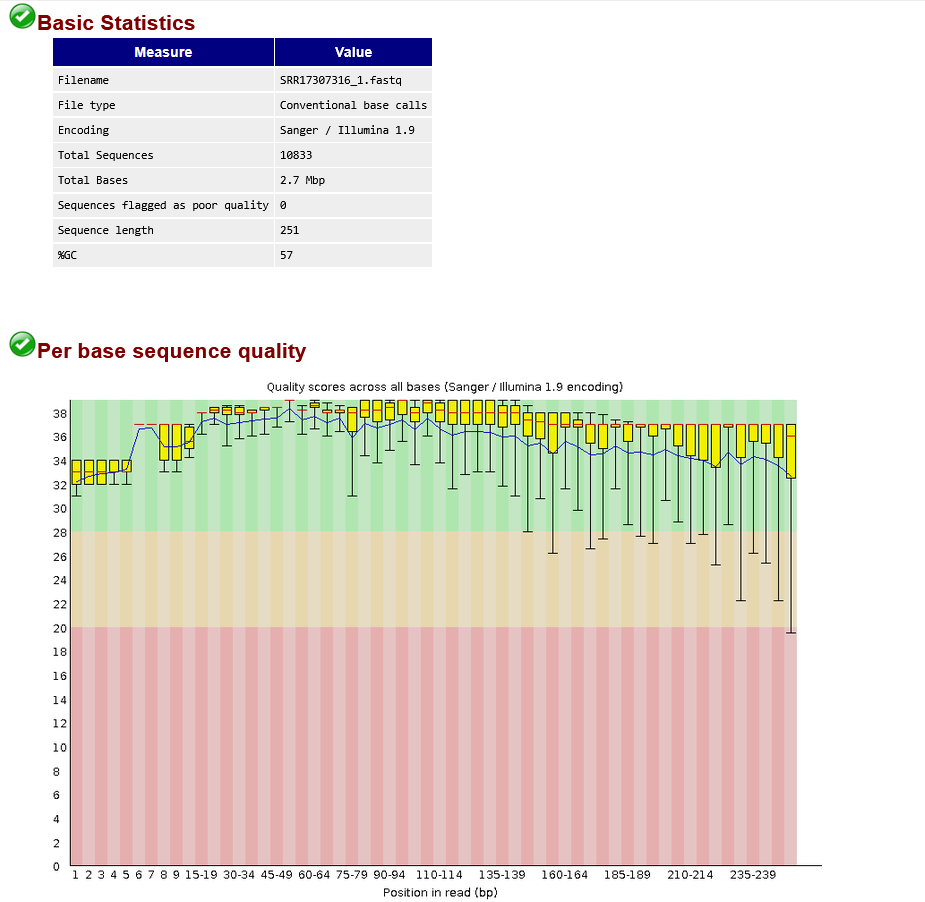
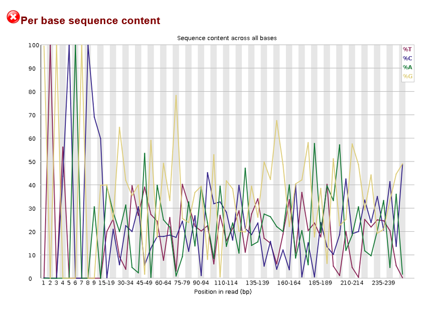
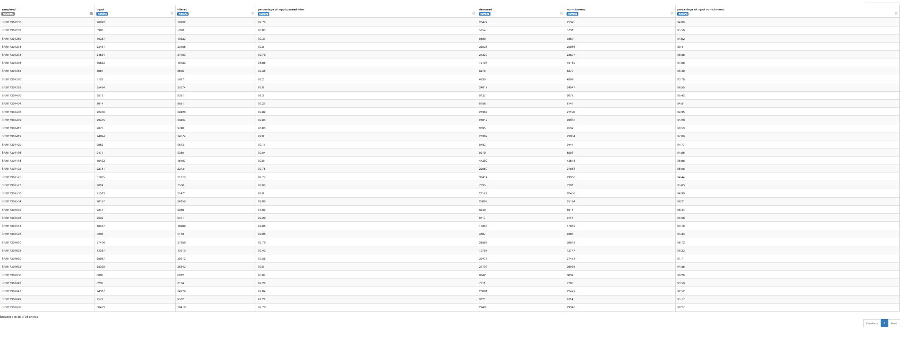
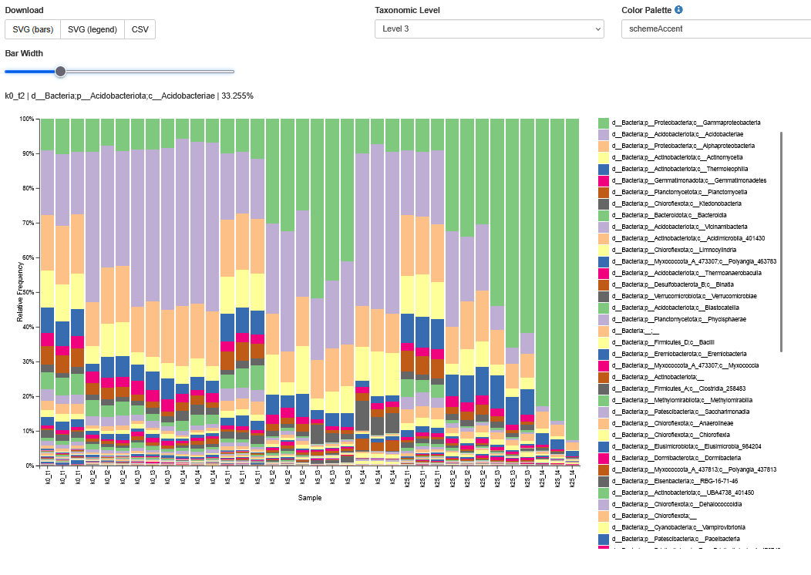
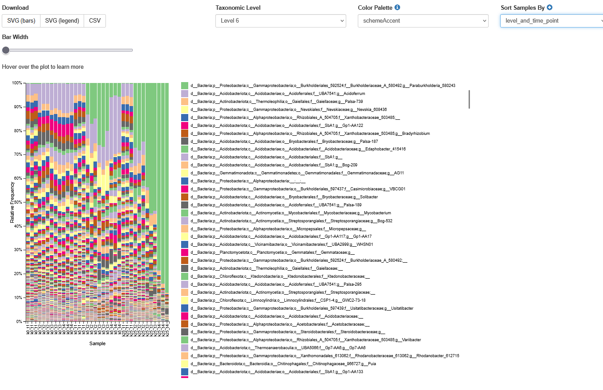
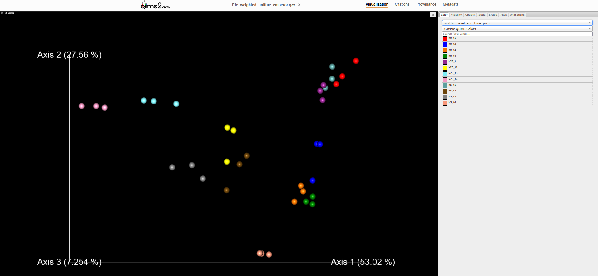
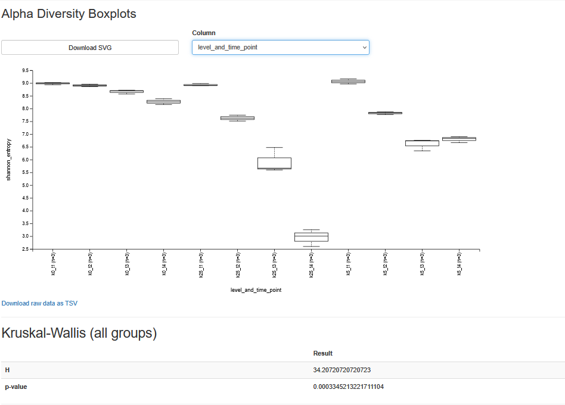

# Влияние загрязнения почвы керосином на бактериальное сообщество

Дерново-подзолистая почва, три варианта: k0 (контроль), k5 (5 г/кг), k25 (25 г/кг). Точки: d3 (t1), d90 (t2), d180 (t3), d360 (t4), по три реплики, всего 36 образцов. Ампликон V4-V5 16S rRNA, Illumina MiSeq 2x250, анализ только по R1.

## Задача 1. FastQC

Взяла образец SRR17307316.

10 833 прочтения, длина 251 нт, GC 57%. Медиана качества 36-38 почти по всей длине, к концу падает до 34, что оправдывает обрезку до 200. Адаптеров нет.

FAIL по трём модулям, все ожидаемы для ампликонов:
- **Per base sequence content:** в первых позициях доли букв 0 или 100%, это праймер 515F;
- **Duplication / Overrepresented:** один локус читается у всех клеток таксона, дубликаты тут норма;
- **GC content (WARN):** смесь геномов с разным GC.

## Задача 2. Зачем `--p-trim-left 25`

Прочтение начинается с праймера 515F (19 нт), это синтетическая последовательность, а не геномная. В нём есть вырожденная позиция M (A/C), из-за которой DADA2 выделял бы ложные ASV. Кроме того, праймер маскирует реальные различия в этой области, а первые позиции Illumina нестабильны по составу. 25 взято с запасом.

## Задача 3. Статистики фильтрации

Из 641 362 прочтений осталось 608 362, то есть **94.9%** (по образцам 89.4-97.1%). Фильтр по качеству почти ничего не отсекает, основные потери на денойзинге и химерах.

Самый большой образец SRR17307475 (43 518), самый маленький SRR17307380 (4 809), разница почти в 9 раз.

Качество данных хорошее, но глубина сильно неравномерная, поэтому для оценки разнообразия нужен rarefaction. Глубину взяла 4800 по минимальному образцу.

## Задача 4. Почему хватает классификатора на V4

После обрезки остаётся 175 нт сразу за праймером 515F, то есть позиции примерно 534-709. V4 заканчивается около 806, значит весь фрагмент внутри V4, а V5 был бы только в R2. Классификатор должен быть обучен на том же участке, что и запросы, а `backbone.v4` обучен ровно на вырезке 515F/806R.

## Задача 5. Таксономический состав

В первой точке все три группы практически одинаковые, доминируют Acidobacteriae (~33%), Alphaproteobacteria, Actinomycetia. Контроль со временем почти не меняется. В загрязнённых образцах разрастаются Gammaproteobacteria: до 50-60% при k5 и до 80-90% при k25 к последней точке. Эффект дозозависимый и растёт со временем.

На уровне рода почти вся эта масса приходится на **Paraburkholderia** (Burkholderiaceae). Это ожидаемо: Burkholderiaceae известны как деструкторы углеводородов и могут использовать керосин как источник углерода, а олиготрофные Acidobacteriae под действием керосина вытесняются.

## Задача 6. Бета-разнообразие (weighted UNIFRAC)

Axis 1 объясняет 53%, Axis 2 27.6%, Axis 3 7.3%.

В первой точке все образцы лежат одним кластером. Дальше загрязнённые уходят влево по Axis 1: k25 сильнее и монотонно до t4, k5 слабее. Контроль остаётся на месте.

Признаки восстановления есть только при k5: k5_t4 не продолжает уходить влево, а смещается по Axis 2/3. При k25 восстановления за год нет.

## Задача 7. Индекс Шеннона

| | t1 | t2 | t3 | t4 |
|---|---|---|---|---|
| k0 | 8.98 | 8.90 | 8.66 | 8.27 |
| k5 | 9.06 | 7.82 | 6.61 | 6.80 |
| k25 | 8.93 | 7.63 | 5.91 | 2.95 |

Краскел-Уоллис: H = 34.21, p = 3.3e-4.

В первой точке группы неразличимы. Контроль снижается слабо. k5 падает до d180 и к d360 немного отыгрывает, что совпадает с PCoA. k25 падает монотонно до 2.95, почти втрое ниже контроля: сообщество сведено к нескольким доминантам, прежде всего Paraburkholderia.

## Выводы

1. Керосин перестраивает сообщество дозозависимо, эффект виден с d90 и растёт со временем.
2. Разнообразное сообщество с Acidobacteriae замещается монодоминантным сообществом Paraburkholderia.
3. При 5 г/кг к концу года есть признаки восстановления, при 25 г/кг нет.
